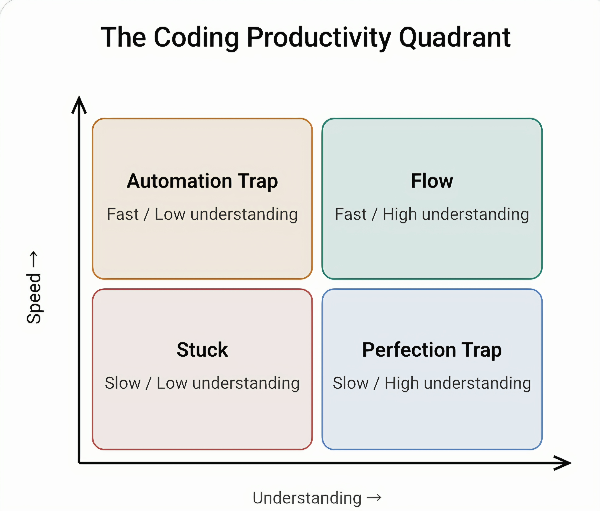

I was revisiting some thoughts I'd collected in [QuoteKeeper](https://quotekeeperapp.netlify.app/), an app I built to save and organize quotations. As I explored the collection, two quotes caught my attention.

The first concerned learning:

> "Understanding the decisions behind the code matters more than writing every line yourself."

The second concerned growth:

> "The obstacles slowing us down might actually be teaching us how to build."

At first glance, these seem like different observations.

One is about AI-assisted programming and the importance of understanding code.

The other is about encountering difficulties and learning from them.

But I began to wonder whether they were describing the same underlying principle.

**What if difficulty isn't necessarily an interruption to learning? What if difficulty is sometimes the very mechanism through which learning happens?**

That question led me back to my Coding Productivity Model.

## Speed Is Not the Same as Progress

Modern development tools allow us to create software at astonishing speeds.

AI can generate components, troubleshoot errors, configure dependencies, and assemble entire applications.

I've experienced this firsthand while building Pennington Labs.

But speed introduces an interesting problem.

A developer might produce hundreds of lines of working code without understanding the architectural decisions behind them.

The application works. The deployment succeeds. The feature is complete.

But has the developer learned anything?

In my Coding Productivity Model, this is what I call the **Automation Trap**: high speed combined with low understanding.

The trap isn't using automation.

The trap is confusing the speed of production with the growth of knowledge.

## When the Obstacle Becomes the Teacher

Now consider a different experience.

You're building an application when something breaks.

A Firebase authentication request fails. A dependency introduces a compatibility issue. A deployment works locally but fails in production.

Suddenly, progress stops.

You investigate. You read documentation. You examine logs. You question your assumptions.

Perhaps you ask AI for help, but instead of immediately accepting a generated solution, you try to understand why the problem occurred.

Eventually, you solve it.

The application moves forward.

But something else has happened.

**You now understand a part of the system that was previously invisible to you.**

The obstacle changed your relationship with the code.

And that's when I began seeing the connection between those two cipherMuse quotes.

Understanding often grows because something forces us to examine what we previously took for granted.

Of course, not every obstacle is productive. Repeating the same mistake without learning, fighting unnecessary complexity, or struggling with broken tools can simply waste time.

The productive obstacle is the one that leaves us with greater understanding.

## The Difference Between Being Stuck and Learning

My Coding Productivity Model contains four quadrants:

- **Automation Trap:** Fast progress, low understanding.
- **Flow:** Fast progress, high understanding.
- **Stuck:** Slow progress, low understanding.
- **Perfection Trap:** Slow progress, high understanding.

Here's something worth exploring further.

Two developers might appear equally slow.

One is repeatedly fighting a problem without making sense of it.

The other is carefully investigating a difficult system, testing assumptions, and building a deeper mental model.

Their speed may be identical.

But their learning experiences are very different.

And even the developer gaining understanding must eventually decide when to stop investigating and move forward.

**The goal isn't to make development difficult. It's to recognize when difficulty is creating something valuable.**

Sometimes slowing down today is what makes meaningful speed possible tomorrow.

## When Two Quotes Become a Third Idea

This brings me to another Pennington Labs project: QuoteKeeper.

I've collected thousands of quotations from writers, poets, philosophers, and thinkers.

And I've accumulated hundreds of observations from cipherMuse about software development, learning, and life.

Imagine being able to search those quotations not merely by author or keyword, but by the ideas connecting them.

A thought about programming might connect to an Emerson essay.

A poem by Larry Levis might illuminate an observation about growth.

Something from Ray Bradbury might challenge an assumption about creativity.

I want to build a feature called **QuoteKeeper Discover** that helps uncover those relationships.

Not just finding quotations that say similar things, but identifying connections, contradictions, and questions that might otherwise remain hidden.

The two cipherMuse quotes that inspired this article demonstrate exactly why I find that possibility exciting.

Neither quote was originally written to explain the other.

Yet placing them together suggested a new idea:

**The Productive Obstacle.**

And that idea became the article you're reading.

## What Are We Really Building?

When I began programming, one of my goals was learning how to write software.

Today, with increasingly capable AI development tools, I find myself asking a slightly different question.

What does it mean to understand the software we're building?

Perhaps understanding isn't measured by how many lines of code we personally write.

Perhaps it isn't measured by how quickly we complete a project, either.

Maybe understanding is revealed by our ability to explain decisions, recognize problems, evaluate alternatives, and learn when things don't go as expected.

The best tools can accelerate our work.

The best obstacles can deepen our understanding.

And productive development may require learning when to embrace each.

---

**A question worth carrying into the next project:**

*When something slows me down, am I merely losing time, or am I gaining understanding that will serve me long after this problem is solved?*

Sometimes the obstacle is just an obstacle.

But sometimes, hidden inside it, is the lesson we needed.

---

*From the Pennington Labs Coding Productivity series. Inspired by two cipherMuse observations and the evolving concept behind QuoteKeeper Discover.*
