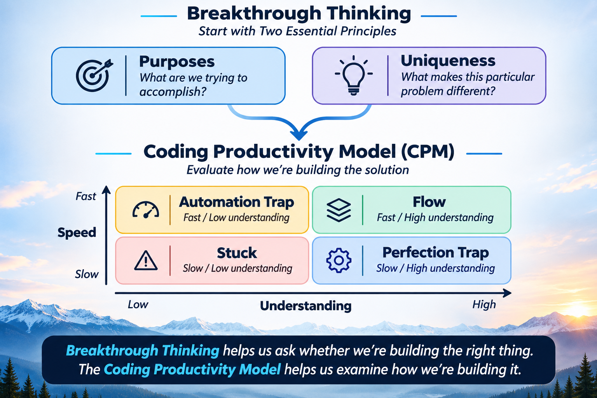

## What Breakthrough Thinking Can Teach Us About Building Software

I've been reading *Breakthrough Thinking* by Gerald Nadler and Shozo Hibino, and something in the opening pages caught my attention.

The authors introduce seven principles for approaching problems differently.

But here's what surprised me.

They explain that you don't necessarily need to apply all seven principles to every problem. Instead, they emphasize two essentials:

**Uniqueness and Purposes.**

That got me thinking about software development.

We spend considerable time learning programming languages, frameworks, debugging techniques, and increasingly powerful AI tools.

But how often do we stop to question the problem we're trying to solve before we begin writing code?

## Every Problem Begins With Change

Early in the book, the authors ask:

> "For what is any problem but a need to respond to change..."

I found that observation fascinating.

A bug appears because something isn't behaving as expected. A customer requests a feature because their needs have changed. A developer replaces an existing system because it no longer serves its original purpose.

Even creating a new application usually begins with recognizing that something could work differently.

Perhaps software development is fundamentally about responding to change.

But recognizing that change is needed doesn't automatically tell us what to build.

That's where the two essential principles become valuable.

## Principle One: Uniqueness

The Uniqueness Principle encourages us to recognize that every problem exists within its own circumstances.

Consider how developers often approach new projects.

We search GitHub. We watch tutorials. We find a similar application. We adopt an architecture that worked for someone else.

There's nothing inherently wrong with learning from existing solutions.

But the authors offer a warning:

> "Simply copying someone else's methods guarantees we will remain behind."

That made me think.

When we copy a solution without examining our own circumstances, we may be solving someone else's problem rather than our own.

Two applications might look similar while serving entirely different needs.

The users are different. The environments are different. The expectations are different.

A successful solution for one project may be an unnecessary complication for another.

**Before choosing the solution, shouldn't we first understand what makes our problem unique?**

## Principle Two: Purposes

Of the quotations I collected, this one may be my favorite:

> "Don't ask, What's wrong here? What's the matter? Instead, ask, What are we trying to accomplish here? what are we trying to do?"

That is a remarkable shift in perspective.

Imagine encountering a problem in an application.

Our instinct is often to ask what broke, locate the offending code, and repair it.

But what happens when we ask what we're actually trying to accomplish?

The conversation changes.

Instead of simply making a broken feature work, we begin examining whether the feature serves its intended purpose.

And sometimes that reveals a better solution.

## A Lesson From Building TipCalc

I experienced something similar while developing TipCalc, a small Android application I published through Pennington Labs.

One piece of feedback from testers concerned changing tip percentages.

Originally, users had to reenter the bill amount when comparing different tips.

I could have approached this as a narrow programming problem:

*How do I keep the number from disappearing?*

But consider the larger purpose.

**The user wants to compare tip amounts quickly and easily.**

That changes how we think about the feature.

The goal isn't merely preserving a number. It's making comparisons effortless.

The resulting update allowed users to change tip percentages without losing the bill amount. We also improved the visibility of totals and the landscape layout.

Looking back, I can see both Breakthrough Thinking principles at work.

**Uniqueness:** What do these particular users need from this particular calculator?

**Purposes:** What are they ultimately trying to accomplish?

The solution becomes clearer when we start with those questions.

## What Happens After the Solution?

Another idea from the book really caught my attention:

> "...focus(es) on the 'solution-after-next.'"

The authors also ask what happens after a solution has been implemented.

That's an interesting question for programmers.

We often think of deployment as the finish line.

But a completed feature changes the application. New behavior creates new expectations. Users discover additional possibilities. Maintenance introduces new challenges.

The solution becomes part of the next problem.

Think about an application that successfully handles its first hundred users.

What happens when it reaches ten thousand?

Or a feature that works beautifully on one phone.

What happens when someone opens it in landscape orientation on a different device?

We don't need to anticipate every possible future problem.

But perhaps we should think beyond the immediate fix.

The authors remind us:

> "...today's choices create the future."

That observation applies directly to software architecture, testing, documentation, and maintainability.

What we build today shapes what becomes possible tomorrow.

## When Expertise Gets in the Way

One final observation from the opening pages surprised me:

> "Being expert in the details of a problem can prevent you from seeing some of the better alternatives."

That one deserves some reflection.

As developers, we work hard to understand technical details.

And we should.

But knowing a system intimately can sometimes make us less willing to question its assumptions.

We become so focused on improving the existing implementation that we overlook the possibility of a different approach.

I've wondered whether AI-assisted development might offer an interesting opportunity here.

AI can help us explore alternatives we might not have considered.

But it can also produce familiar solutions based on familiar patterns.

The developer still needs to ask the better question.

**Are we improving the existing solution, or discovering whether a better solution is possible?**

## Two Questions to Carry Into Every Project

I'm only beginning to explore *Breakthrough Thinking*, and I certainly don't claim to have mastered its seven principles.

But I like the authors' suggestion that we can begin with just two.

Before starting the next application, implementing the next feature, or debugging the next difficult problem, I'm going to try asking:

**1. What makes this particular problem unique?**

**2. What are we ultimately trying to accomplish?**

And perhaps I'll add a third question inspired by the book:

**3. What happens after this solution works?**

These questions won't eliminate bugs, prevent every architectural mistake, or make development effortless.

But they might help us recognize when we're solving the wrong problem.

And sometimes the most productive thing a developer can do isn't writing another line of code.

It's asking a better question before writing the first one.

## Connecting Breakthrough Thinking to the Coding Productivity Model

As I reflected on these principles, I began wondering how they might connect to my Coding Productivity Model (CPM).

The model examines development through two dimensions: speed and understanding. It describes four possible states: the Automation Trap, Flow, Stuck, and the Perfection Trap.

At first, I wondered whether the two Breakthrough Thinking principles belonged somewhere inside those four quadrants.

But I realized they answer different questions.

Purposes and Uniqueness can guide a developer working in any quadrant. They don't guarantee speed or understanding. Instead, they help establish what problem deserves our attention and why.

The Coding Productivity Model then helps us reflect on how we're approaching the development itself.

That brings the two ideas together:

*Breakthrough Thinking helps us ask whether we're building the right thing. The Coding Productivity Model helps us examine how we're building it.*

---

*Part of the Pennington Labs Breakthrough Thinking series. Inspired by the opening chapters of Gerald Nadler and Shozo Hibino's* Breakthrough Thinking *and my experiences building software with Pennington Labs.*
